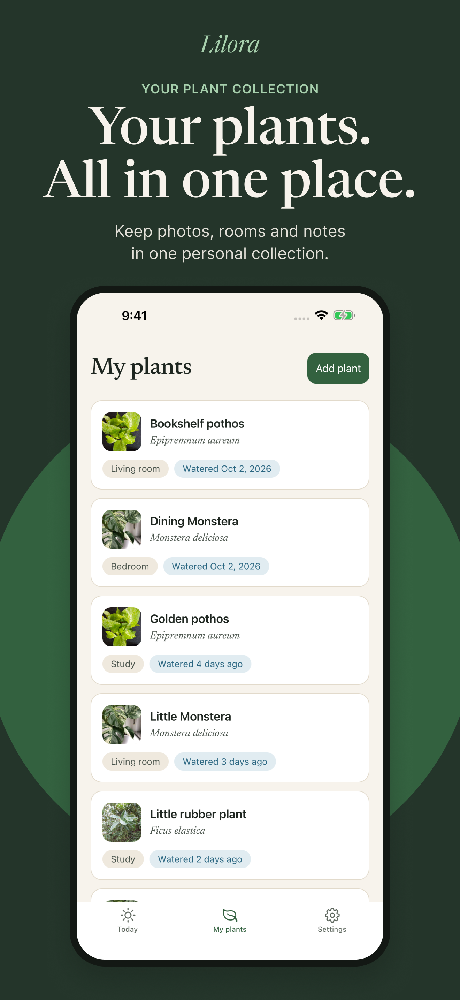
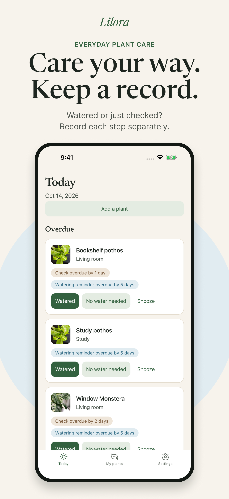
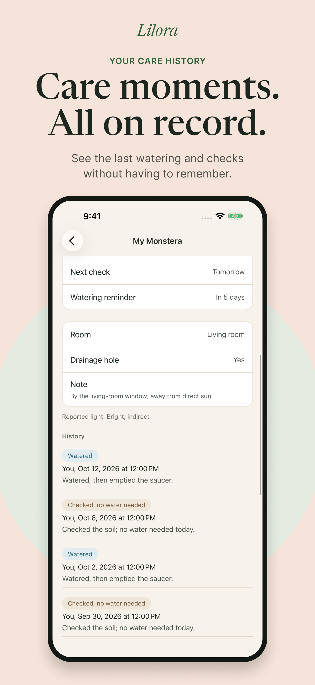

  <section class="promo-hero wrap">
    

Lilora
Plant care app for iPhone &amp; iPad

<h1>Know what your plants need next.</h1>
Track watering, set care reminders and share plant history with your household. Add your first plant for free in Lilora. No account needed to start.

    
Everyday care is free. · Start without an account

    

<small class="promo-language">Free to download · Optional in-app purchases</small><small class="promo-language">App in English and Turkish</small>
<a class="text-link" href="#how-it-works">See how it works ↓</a>

    <figure class="promo-qr promo-hero-qr"><figcaption>Scan with your phone to open Lilora on the App Store.</figcaption></figure>

    <figure class="promo-hero-media">

<picture><source type="image/webp" srcset="/assets/images/home/app-en-collection-320.webp 320w, /assets/images/home/app-en-collection-480.webp 480w, /assets/images/home/app-en-collection-720.webp 720w" sizes="(min-width: 1200px) 250px, (min-width: 900px) 23vw, (min-width: 600px) 260px, 43vw"></picture>

<picture><source type="image/webp" srcset="/assets/images/home/app-en-care-320.webp 320w, /assets/images/home/app-en-care-480.webp 480w, /assets/images/home/app-en-care-720.webp 720w" sizes="(min-width: 1200px) 250px, (min-width: 900px) 23vw, (min-width: 600px) 260px, 43vw"></picture>

<figcaption class="promo-hero-caption">Store artwork made from a real app screen with sample plant records. App shown in English.</figcaption></figure>
  </section>
  <nav class="promo-paths wrap" aria-label="See how it works"><a href="#how-it-works">See how it works ↗</a><a href="#free-care">Everyday care is free. ↗</a><a href="/guides/">undefined ↗</a></nav>
  <section class="promo-how" id="how-it-works">

    

How a household uses it
<h2>Look first. Record what you did.</h2>
A reminder does not mean a plant needs water. Lilora gives your observations and care a shared record that the next person can read.

    <ol class="promo-steps"><li>1
<h3>Check the plant and its soil</h3>
See which plants are due for a check in Today. Take a look before deciding whether to water.

</li><li>2
<h3>Record what actually happened</h3>
“Watered” and “Checked, no water needed” are different care records. A check on its own does not become a watering.

</li><li>3
<h3>Let the household know</h3>
In your private household, see who cared for each plant and when. The next person can read the history before doing the same job.

</li></ol>

    
<figure class="promo-app"><picture><source type="image/webp" srcset="/assets/images/home/app-en-care-320.webp 320w, /assets/images/home/app-en-care-480.webp 480w, /assets/images/home/app-en-care-720.webp 720w" sizes="(min-width: 900px) 260px, (min-width: 600px) 240px, 44vw"></picture><figcaption>App shown in English. Store artwork made from a real app screen with sample plant records.</figcaption></figure><figure class="promo-app"><picture><source type="image/webp" srcset="/assets/images/home/app-en-history-320.webp 320w, /assets/images/home/app-en-history-480.webp 480w, /assets/images/home/app-en-history-720.webp 720w" sizes="(min-width: 900px) 260px, (min-width: 600px) 240px, 44vw"></picture><figcaption>App shown in English. Store artwork made from a real app screen with sample plant records.</figcaption></figure>

  
</section>
  <section class="wrap promo-features" id="features"><header class="promo-section-heading">
Lilora
<h2>A place for the plant. A record of its care.</h2></header>
<article class="promo-feature-card">
    
01
<h3>Plants, with a room of their own</h3>
Organise plants by room. Keep their names, photos and notes together, even when you do not know the species.

  </article><article class="promo-feature-card">
    
02
<h3>A reminder to look</h3>
Reminders bring you back to the plant. They prompt a check, not an automatic watering when the soil is still wet.

  </article><article class="promo-feature-card">
    
03
<h3>Checks and waterings, kept apart</h3>
Find the last care entry at a glance. Separate watering and check records show who did what and when.

  </article><article class="promo-feature-card">
    
04
<h3>One home, shared care</h3>
Use an account to create a private household or accept an invitation. Share plants and care records with the people in that household.

  </article><article class="promo-feature-card">
    
05
<h3>A little help with the name</h3>
With an account, you can choose photo identification. Review the suggestions from Pl@ntNet and confirm the result before adding your plant.

  </article><article class="promo-feature-card">
    
06
<h3>Start without an account</h3>
Add plants yourself and keep photos, notes and care records. Guest records stay on this device; deleting the app deletes those records too.

  </article>
</section>
  <section class="promo-free" id="free-care">
<header class="promo-section-heading"><h2>Everyday care is free.</h2>
Adding plants yourself, organising rooms and keeping photos, notes and care history require no purchase. Paid options are for optional photo identification.

<small class="promo-language">Free to download · Optional in-app purchases</small><small class="promo-language">App in English and Turkish</small>
</header>
<dl class="promo-plan-list">
<dt>A free plant notebook</dt><dd>Plants, rooms, photos, notes and care records.</dd>

<dt>3 free identifications per account</dt><dd>A starting allowance to try photo identification. It does not renew each month.</dd>

<dt>10-identification pack</dt><dd>An optional one-off purchase when you want more identifications.</dd>

<dt>Lilora Plus Monthly</dt><dd>An auto-renewing monthly subscription with 30 identifications per month. Unused identifications do not roll over.</dd>
</dl>
Prices are shown on the App Store in your currency.

</section>
  {{HOME_EDITORIAL}}
  <section class="wrap promo-faq"><h2>Before you begin</h2>

Can I download Lilora now?

Yes. Lilora is available on the App Store for iPhone and iPad. Manual plants and care records are free.

Which devices and languages does it support?

Lilora is available for iPhone and iPad. The app is in English and Turkish; the website is in ten languages.

Do I need a subscription for plant care?

No. Adding plants yourself and recording care are free. Purchases only provide allowances for optional photo identification.

Do I need an account?

You can start as a guest on your own device. Sharing a household, photo identification and purchases require an account. Guest records are stored on the device and are deleted when you delete the app.

Should I water when a reminder arrives?

Check the plant and its soil first. A reminder is not an instruction to water. If water is not needed, you can record that as a separate check.

<a class="text-link" href="/support/">Find more answers in support →</a>
</section>
  <section class="promo-band">

<h2>Start with your first plant.</h2>
Add a plant, choose its room and record today’s care. No purchase needed for everyday plant care.

<small class="promo-language">App in English and Turkish</small>
On the App Store

<figure class="promo-qr"><figcaption>Scan with your phone to open Lilora on the App Store.</figcaption></figure>
</section>
  

