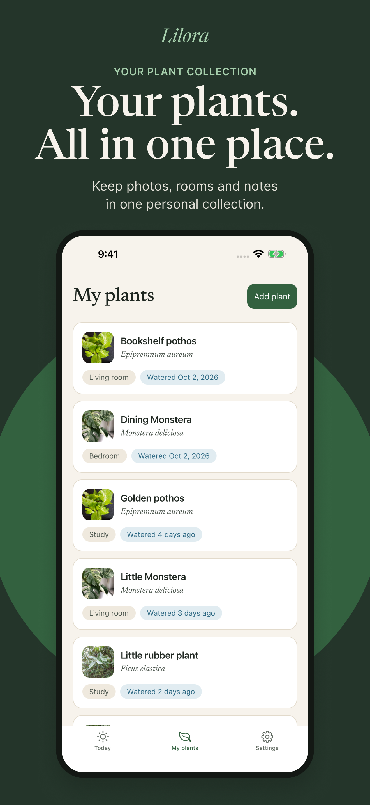
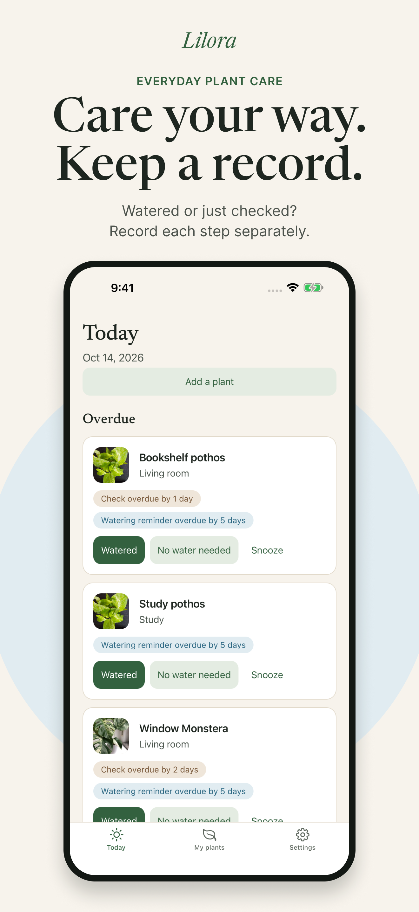
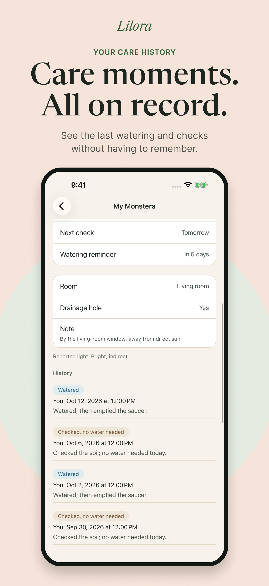

  <section class="promo-hero wrap">
    

Lilora
App pour plantes sur iPhone et iPad

<h1>Vos plantes, dans une seule app.</h1>
Identifiez vos plantes en photo, créez des rappels et gardez une trace des soins. Téléchargez Lilora sur iPhone et iPad pour partager leur entretien.

    
Les soins du quotidien sont gratuits. · Commencer sans compte

    

<small class="promo-language">Téléchargement gratuit · Achats intégrés facultatifs</small><small class="promo-language">L’app est en anglais et en turc</small>
<a class="text-link" href="#how-it-works">Voir comment ça marche ↓</a>

    <figure class="promo-qr promo-hero-qr"><figcaption>Scannez avec votre téléphone pour ouvrir Lilora sur l’App Store.</figcaption></figure>

    <figure class="promo-hero-media">

<picture><source type="image/webp" srcset="/assets/images/home/app-en-collection-320.webp 320w, /assets/images/home/app-en-collection-480.webp 480w, /assets/images/home/app-en-collection-720.webp 720w" sizes="(min-width: 1200px) 250px, (min-width: 900px) 23vw, (min-width: 600px) 260px, 43vw"></picture>

<picture><source type="image/webp" srcset="/assets/images/home/app-en-care-320.webp 320w, /assets/images/home/app-en-care-480.webp 480w, /assets/images/home/app-en-care-720.webp 720w" sizes="(min-width: 1200px) 250px, (min-width: 900px) 23vw, (min-width: 600px) 260px, 43vw"></picture>

<figcaption class="promo-hero-caption">Visuel pour la boutique créé à partir d’un véritable écran de l’app, avec des fiches de plantes d’exemple. App présentée en anglais.</figcaption></figure>
  </section>
  <nav class="promo-paths wrap" aria-label="Voir comment ça marche"><a href="#how-it-works">Voir comment ça marche ↗</a><a href="#free-care">Les soins du quotidien sont gratuits. ↗</a><a href="/fr/guides/">undefined ↗</a></nav>
  <section class="promo-how" id="how-it-works">

    

L’entretien à plusieurs, au quotidien
<h2>Observer d’abord. Noter ensuite.</h2>
Un rappel ne signifie pas qu’une plante a besoin d’eau. Lilora réunit observations et soins dans un historique que la personne suivante peut consulter.

    <ol class="promo-steps"><li>1
<h3>Vérifier la plante et le terreau</h3>
Dans « Today », retrouvez les plantes à vérifier. Prenez le temps de les observer avant de décider s’il faut arroser.

</li><li>2
<h3>Noter ce qui a été fait</h3>
« Watered » et « Checked, no water needed » sont deux entrées distinctes : arrosée, ou vérifiée sans besoin d’eau. Une vérification ne compte pas comme un arrosage.

</li><li>3
<h3>Tenir la maisonnée au courant</h3>
Dans votre foyer privé, voyez qui s’est occupé de chaque plante et quand. La personne suivante peut consulter l’historique avant de refaire le même geste.

</li></ol>

    
<figure class="promo-app"><picture><source type="image/webp" srcset="/assets/images/home/app-en-care-320.webp 320w, /assets/images/home/app-en-care-480.webp 480w, /assets/images/home/app-en-care-720.webp 720w" sizes="(min-width: 900px) 260px, (min-width: 600px) 240px, 44vw"></picture><figcaption>App présentée en anglais. Visuel pour la boutique créé à partir d’un véritable écran de l’app, avec des fiches de plantes d’exemple.</figcaption></figure><figure class="promo-app"><picture><source type="image/webp" srcset="/assets/images/home/app-en-history-320.webp 320w, /assets/images/home/app-en-history-480.webp 480w, /assets/images/home/app-en-history-720.webp 720w" sizes="(min-width: 900px) 260px, (min-width: 600px) 240px, 44vw"></picture><figcaption>App présentée en anglais. Visuel pour la boutique créé à partir d’un véritable écran de l’app, avec des fiches de plantes d’exemple.</figcaption></figure>

  
</section>
  <section class="wrap promo-features" id="features"><header class="promo-section-heading">
Lilora
<h2>Une place pour chaque plante. Une trace de chaque soin.</h2></header>
<article class="promo-feature-card">
    
01
<h3>Des plantes classées par pièce</h3>
Gardez leurs noms, photos et notes ensemble. Vous pouvez ajouter une plante même si vous ne connaissez pas encore son espèce.

  </article><article class="promo-feature-card">
    
02
<h3>Un rappel pour observer</h3>
Les rappels vous invitent à regarder la plante. Ils proposent de vérifier, pas d’arroser automatiquement un terreau encore humide.

  </article><article class="promo-feature-card">
    
03
<h3>Vérifications et arrosages, séparément</h3>
Retrouvez le dernier soin en un coup d’œil. L’historique distingue les arrosages des vérifications et indique qui les a faits et quand.

  </article><article class="promo-feature-card">
    
04
<h3>Une maison, des soins partagés</h3>
Avec un compte, créez un foyer privé ou acceptez une invitation. Partagez les plantes et leur historique avec les personnes de ce foyer.

  </article><article class="promo-feature-card">
    
05
<h3>Un coup de main pour trouver son nom</h3>
Avec votre compte, vous pouvez choisir l’identification par photo. Examinez les suggestions de Pl@ntNet et confirmez le résultat avant d’ajouter la plante.

  </article><article class="promo-feature-card">
    
06
<h3>Commencer sans compte</h3>
Ajoutez vos plantes vous-même et gardez photos, notes et soins. Les données du mode invité restent sur cet appareil ; supprimer l’app les supprime aussi.

  </article>
</section>
  <section class="promo-free" id="free-care">
<header class="promo-section-heading"><h2>Les soins du quotidien sont gratuits.</h2>
Ajouter ses plantes soi-même, organiser les pièces et conserver photos, notes et historique ne nécessite aucun achat. Les options payantes concernent l’identification facultative par photo.

<small class="promo-language">Téléchargement gratuit · Achats intégrés facultatifs</small><small class="promo-language">L’app est en anglais et en turc</small>
</header>
<dl class="promo-plan-list">
<dt>Un carnet de plantes gratuit</dt><dd>Plantes, pièces, photos, notes et historique des soins.</dd>

<dt>3 identifications gratuites par compte</dt><dd>Un quota de départ pour essayer l’identification par photo. Il n’est pas renouvelé chaque mois.</dd>

<dt>Un pack de 10 identifications</dt><dd>Un achat ponctuel et facultatif pour disposer d’identifications supplémentaires.</dd>

<dt>Lilora Plus Monthly</dt><dd>Un abonnement mensuel à renouvellement automatique comprenant 30 identifications par mois. Les identifications inutilisées ne sont pas reportées au mois suivant.</dd>
</dl>
Les prix sont indiqués sur l’App Store dans votre devise.

</section>
  {{HOME_EDITORIAL}}
  <section class="wrap promo-faq"><h2>Avant de commencer</h2>

Puis-je déjà télécharger Lilora ?

Oui. Lilora est disponible sur l’App Store pour iPhone et iPad. Le suivi manuel des plantes et des soins est gratuit.

Quels appareils et quelles langues sont pris en charge ?

Lilora est disponible sur iPhone et iPad. L’app est en anglais et en turc ; le site est proposé en dix langues.

Faut-il un abonnement pour l’entretien des plantes ?

Non. Ajouter ses plantes soi-même et noter les soins est gratuit. Les achats donnent uniquement accès à des identifications supplémentaires par photo, une fonction facultative.

Dois-je créer un compte ?

Vous pouvez commencer en mode invité sur votre appareil. Un compte est nécessaire pour partager un foyer, identifier une plante par photo ou effectuer des achats. Les données du mode invité sont locales et sont effacées si vous supprimez l’app.

Faut-il arroser à chaque rappel ?

Vérifiez d’abord la plante et le terreau. Un rappel n’est pas une consigne d’arrosage. Si la plante n’a pas besoin d’eau, vous pouvez enregistrer une vérification distincte.

<a class="text-link" href="/fr/support/">Plus de réponses dans l’aide →</a>
</section>
  <section class="promo-band">

<h2>Un historique utile pour le prochain soin.</h2>
Ouvrez Lilora sur l’App Store ou scannez le code avec votre iPhone ou iPad.

<small class="promo-language">L’app est en anglais et en turc</small>
Sur l’App Store

<figure class="promo-qr"><figcaption>Scannez avec votre téléphone pour ouvrir Lilora sur l’App Store.</figcaption></figure>
</section>
  

