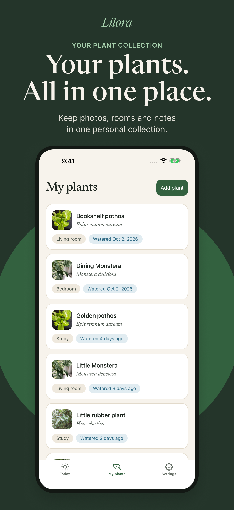
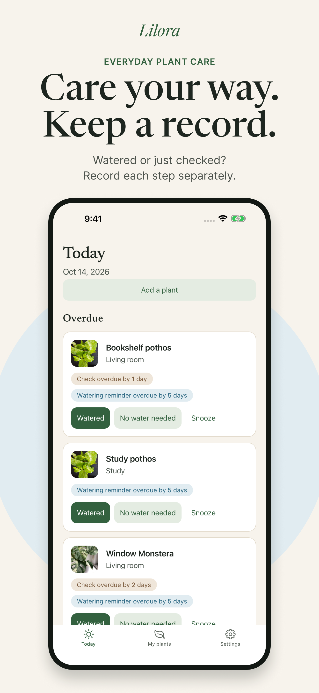
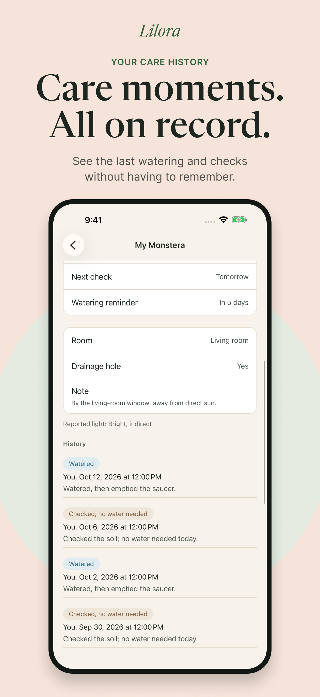

  <section class="promo-hero wrap">
    

Lilora
App per le piante su iPhone e iPad

<h1>Le tue piante, in una sola app.</h1>
Identifica le piante da foto, imposta promemoria e registra le cure. Scarica Lilora per iPhone e iPad e condividi la cura delle piante con chi vive con te.

    
Le cure quotidiane sono gratuite. · Inizia senza account

    

<small class="promo-language">Download gratuito · Acquisti in-app facoltativi</small><small class="promo-language">App in inglese e turco</small>
<a class="text-link" href="#how-it-works">Scopri come funziona ↓</a>

    <figure class="promo-qr promo-hero-qr"><figcaption>Scansiona con il telefono per aprire Lilora sull’App Store.</figcaption></figure>

    <figure class="promo-hero-media">

<picture><source type="image/webp" srcset="/assets/images/home/app-en-collection-320.webp 320w, /assets/images/home/app-en-collection-480.webp 480w, /assets/images/home/app-en-collection-720.webp 720w" sizes="(min-width: 1200px) 250px, (min-width: 900px) 23vw, (min-width: 600px) 260px, 43vw"></picture>

<picture><source type="image/webp" srcset="/assets/images/home/app-en-care-320.webp 320w, /assets/images/home/app-en-care-480.webp 480w, /assets/images/home/app-en-care-720.webp 720w" sizes="(min-width: 1200px) 250px, (min-width: 900px) 23vw, (min-width: 600px) 260px, 43vw"></picture>

<figcaption class="promo-hero-caption">Immagine per lo store tratta da una schermata reale dell’app con registrazioni di piante di esempio. App mostrata in inglese.</figcaption></figure>
  </section>
  <nav class="promo-paths wrap" aria-label="Scopri come funziona"><a href="#how-it-works">Scopri come funziona ↗</a><a href="#free-care">Le cure quotidiane sono gratuite. ↗</a><a href="/it/guides/">undefined ↗</a></nav>
  <section class="promo-how" id="how-it-works">

    

Come si usa in casa
<h2>Prima osserva. Poi registra ciò che hai fatto.</h2>
Un promemoria non significa che serva acqua. Lilora raccoglie osservazioni e cure in una cronologia condivisa che la persona successiva può leggere.

    <ol class="promo-steps"><li>1
<h3>Controlla la pianta e il substrato</h3>
Nella schermata Today (Oggi) vedi quali piante vanno controllate. Osservale prima di decidere se annaffiare.

</li><li>2
<h3>Registra ciò che è successo davvero</h3>
“Watered” (Annaffiata) e “Checked, no water needed” (Controllata, non serve acqua) sono registrazioni diverse. Un semplice controllo non diventa un’annaffiatura.

</li><li>3
<h3>Informa le persone di casa</h3>
Nel tuo gruppo domestico privato vedi chi si è preso cura di ogni pianta e quando. La persona successiva può consultare la cronologia prima di ripetere lo stesso lavoro.

</li></ol>

    
<figure class="promo-app"><picture><source type="image/webp" srcset="/assets/images/home/app-en-care-320.webp 320w, /assets/images/home/app-en-care-480.webp 480w, /assets/images/home/app-en-care-720.webp 720w" sizes="(min-width: 900px) 260px, (min-width: 600px) 240px, 44vw"></picture><figcaption>App mostrata in inglese. Immagine per lo store tratta da una schermata reale dell’app con registrazioni di piante di esempio.</figcaption></figure><figure class="promo-app"><picture><source type="image/webp" srcset="/assets/images/home/app-en-history-320.webp 320w, /assets/images/home/app-en-history-480.webp 480w, /assets/images/home/app-en-history-720.webp 720w" sizes="(min-width: 900px) 260px, (min-width: 600px) 240px, 44vw"></picture><figcaption>App mostrata in inglese. Immagine per lo store tratta da una schermata reale dell’app con registrazioni di piante di esempio.</figcaption></figure>

  
</section>
  <section class="wrap promo-features" id="features"><header class="promo-section-heading">
Lilora
<h2>Un posto per la pianta. Una cronologia delle sue cure.</h2></header>
<article class="promo-feature-card">
    
01
<h3>Ogni pianta nella sua stanza</h3>
Organizza le piante per stanza. Riunisci nomi, foto e note anche quando non conosci la specie.

  </article><article class="promo-feature-card">
    
02
<h3>Un promemoria per osservare</h3>
I promemoria ti riportano alla pianta. Invitano a controllare, non ad annaffiare automaticamente quando il substrato è ancora bagnato.

  </article><article class="promo-feature-card">
    
03
<h3>Controlli e annaffiature distinti</h3>
Trova subito l’ultima cura registrata. Le registrazioni separate di annaffiature e controlli mostrano chi ha fatto cosa e quando.

  </article><article class="promo-feature-card">
    
04
<h3>Una casa, cure condivise</h3>
Con un account puoi creare un gruppo domestico privato o accettare un invito. Condividi piante e registrazioni delle cure con le persone di quel gruppo.

  </article><article class="promo-feature-card">
    
05
<h3>Un aiuto per trovare il nome</h3>
Con un account puoi scegliere l’identificazione da foto. Esamina i suggerimenti di Pl@ntNet e conferma il risultato prima di aggiungere la pianta.

  </article><article class="promo-feature-card">
    
06
<h3>Inizia senza account</h3>
Aggiungi le piante a mano e conserva foto, note e registrazioni delle cure. I dati come ospite restano su questo dispositivo; eliminando l’app elimini anche questi dati.

  </article>
</section>
  <section class="promo-free" id="free-care">
<header class="promo-section-heading"><h2>Le cure quotidiane sono gratuite.</h2>
Aggiungere piante a mano, organizzare stanze e conservare foto, note e cronologia delle cure non richiede acquisti. Le opzioni a pagamento riguardano l’identificazione facoltativa da foto.

<small class="promo-language">Download gratuito · Acquisti in-app facoltativi</small><small class="promo-language">App in inglese e turco</small>
</header>
<dl class="promo-plan-list">
<dt>Un diario gratuito per le piante</dt><dd>Piante, stanze, foto, note e registrazioni delle cure.</dd>

<dt>3 identificazioni gratuite per account</dt><dd>Una dotazione iniziale per provare l’identificazione da foto. Non si rinnova ogni mese.</dd>

<dt>Pacchetto da 10 identificazioni</dt><dd>Un acquisto facoltativo una tantum quando vuoi altre identificazioni.</dd>

<dt>Lilora Plus Monthly</dt><dd>Un abbonamento mensile a rinnovo automatico con 30 identificazioni al mese. Quelle inutilizzate non si accumulano.</dd>
</dl>
L’App Store mostra i prezzi nella tua valuta.

</section>
  {{HOME_EDITORIAL}}
  <section class="wrap promo-faq"><h2>Prima di iniziare</h2>

Posso scaricare Lilora adesso?

Sì. Lilora è disponibile sull’App Store per iPhone e iPad. Il diario manuale delle piante e delle cure è gratuito.

Quali dispositivi e lingue supporta?

Lilora è disponibile per iPhone e iPad. L’app è in inglese e turco; il sito è in dieci lingue.

Serve un abbonamento per curare le piante?

No. Aggiungere piante a mano e registrare le cure è gratuito. Gli acquisti forniscono soltanto quantità di identificazioni facoltative da foto.

Serve un account?

Puoi iniziare come ospite sul tuo dispositivo. Condividere un gruppo domestico, identificare da foto ed effettuare acquisti richiede un account. I dati come ospite sono conservati sul dispositivo e vengono eliminati quando elimini l’app.

Devo annaffiare quando arriva un promemoria?

Controlla prima la pianta e il substrato. Un promemoria non è un ordine di annaffiare. Se non serve acqua, puoi registrarlo come controllo separato.

<a class="text-link" href="/it/support/">Trova altre risposte nell’assistenza →</a>
</section>
  <section class="promo-band">

<h2>Dai al prossimo controllo una cronologia utile.</h2>
Apri Lilora sull’App Store o scansiona il codice con il tuo iPhone o iPad.

<small class="promo-language">App in inglese e turco</small>
Sull’App Store

<figure class="promo-qr"><figcaption>Scansiona con il telefono per aprire Lilora sull’App Store.</figcaption></figure>
</section>
  

