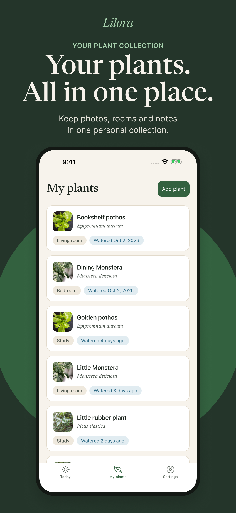
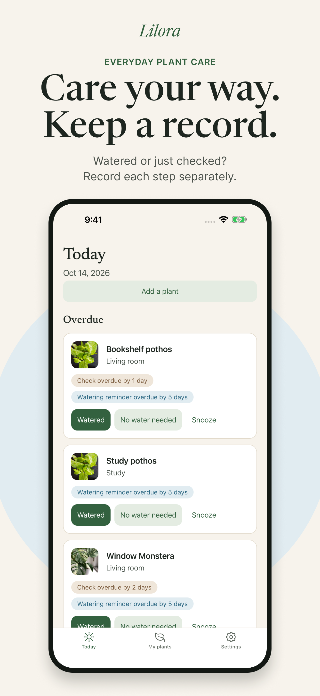
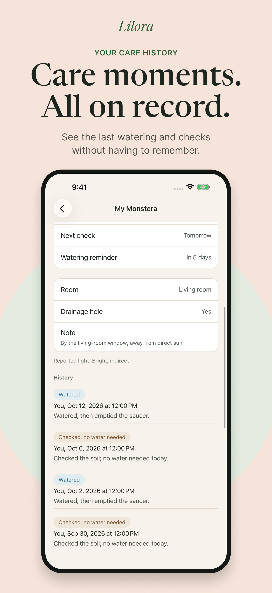

  <section class="promo-hero wrap">
    

Lilora
App de plantas para iPhone e iPad

<h1>Suas plantas em um só app.</h1>
Identifique plantas por foto, crie lembretes de verificação e registre os cuidados. Baixe o Lilora para iPhone e iPad e compartilhe o cuidado em casa.

    
O cuidado do dia a dia é gratuito. · Comece sem criar uma conta

    

<small class="promo-language">Download grátis · Compras opcionais no app</small><small class="promo-language">O app está em inglês e turco</small>
<a class="text-link" href="#how-it-works">Veja como funciona ↓</a>

    <figure class="promo-qr promo-hero-qr"><figcaption>Escaneie com o telefone para abrir o Lilora na App Store.</figcaption></figure>

    <figure class="promo-hero-media">

<picture><source type="image/webp" srcset="/assets/images/home/app-en-collection-320.webp 320w, /assets/images/home/app-en-collection-480.webp 480w, /assets/images/home/app-en-collection-720.webp 720w" sizes="(min-width: 1200px) 250px, (min-width: 900px) 23vw, (min-width: 600px) 260px, 43vw"></picture>

<picture><source type="image/webp" srcset="/assets/images/home/app-en-care-320.webp 320w, /assets/images/home/app-en-care-480.webp 480w, /assets/images/home/app-en-care-720.webp 720w" sizes="(min-width: 1200px) 250px, (min-width: 900px) 23vw, (min-width: 600px) 260px, 43vw"></picture>

<figcaption class="promo-hero-caption">Imagem para a loja criada a partir de uma tela real do app, com registros de plantas de exemplo. App exibido em inglês.</figcaption></figure>
  </section>
  <nav class="promo-paths wrap" aria-label="Veja como funciona"><a href="#how-it-works">Veja como funciona ↗</a><a href="#free-care">O cuidado do dia a dia é gratuito. ↗</a><a href="/pt/guides/">Cuidados com plantas ↗</a></nav>
  <section class="promo-how" id="how-it-works">

    

Como a casa cuida das plantas
<h2>Primeiro observe. Depois registre.</h2>
Um lembrete não significa que a planta precisa de água. O Lilora reúne observações e cuidados num histórico que a próxima pessoa pode consultar.

    <ol class="promo-steps"><li>1
<h3>Confira a planta e o substrato</h3>
Em “Today”, veja quais plantas precisam ser conferidas. Observe antes de decidir se é hora de regar.

</li><li>2
<h3>Registre o que você fez</h3>
“Watered” e “Checked, no water needed” são registros diferentes: regada ou conferida, sem necessidade de água. Uma verificação não vira uma rega.

</li><li>3
<h3>Deixe a casa por dentro</h3>
No grupo privado da casa, veja quem cuidou de cada planta e quando. A próxima pessoa pode consultar o histórico antes de repetir o cuidado.

</li></ol>

    
<figure class="promo-app"><picture><source type="image/webp" srcset="/assets/images/home/app-en-care-320.webp 320w, /assets/images/home/app-en-care-480.webp 480w, /assets/images/home/app-en-care-720.webp 720w" sizes="(min-width: 900px) 260px, (min-width: 600px) 240px, 44vw"></picture><figcaption>App exibido em inglês. Imagem para a loja criada a partir de uma tela real do app, com registros de plantas de exemplo.</figcaption></figure><figure class="promo-app"><picture><source type="image/webp" srcset="/assets/images/home/app-en-history-320.webp 320w, /assets/images/home/app-en-history-480.webp 480w, /assets/images/home/app-en-history-720.webp 720w" sizes="(min-width: 900px) 260px, (min-width: 600px) 240px, 44vw"></picture><figcaption>App exibido em inglês. Imagem para a loja criada a partir de uma tela real do app, com registros de plantas de exemplo.</figcaption></figure>

  
</section>
  <section class="wrap promo-features" id="features"><header class="promo-section-heading">
Lilora
<h2>Cada planta no seu lugar. Cada cuidado registrado.</h2></header>
<article class="promo-feature-card">
    
01
<h3>Plantas organizadas por cômodo</h3>
Guarde nomes, fotos e anotações num só lugar. Você pode adicionar uma planta mesmo sem saber a espécie.

  </article><article class="promo-feature-card">
    
02
<h3>Um lembrete para observar</h3>
Os lembretes ajudam você a olhar a planta de novo. São um convite para conferir, não para regar automaticamente enquanto o substrato ainda está úmido.

  </article><article class="promo-feature-card">
    
03
<h3>Verificações e regas, separadas</h3>
Encontre o último cuidado num olhar. O histórico separa regas e verificações e mostra quem fez cada uma e quando.

  </article><article class="promo-feature-card">
    
04
<h3>Uma casa, cuidados compartilhados</h3>
Com uma conta, crie um grupo privado para sua casa ou aceite um convite. Compartilhe plantas e registros de cuidados com as pessoas desse grupo.

  </article><article class="promo-feature-card">
    
05
<h3>Uma ajuda para descobrir o nome</h3>
Se quiser, use a identificação por foto com sua conta. Confira as sugestões do Pl@ntNet e confirme o resultado antes de adicionar a planta.

  </article><article class="promo-feature-card">
    
06
<h3>Comece sem criar uma conta</h3>
Adicione suas plantas manualmente e guarde fotos, anotações e cuidados. Os registros de visitante ficam só neste dispositivo; apagar o app também apaga esses registros.

  </article>
</section>
  <section class="promo-free" id="free-care">
<header class="promo-section-heading"><h2>O cuidado do dia a dia é gratuito.</h2>
Adicionar plantas manualmente, organizar cômodos e guardar fotos, anotações e histórico de cuidados não exige nenhuma compra. As opções pagas são para a identificação opcional por foto.

<small class="promo-language">Download grátis · Compras opcionais no app</small><small class="promo-language">O app está em inglês e turco</small>
</header>
<dl class="promo-plan-list">
<dt>Um caderno de plantas gratuito</dt><dd>Plantas, cômodos, fotos, anotações e registros de cuidados.</dd>

<dt>3 identificações gratuitas por conta</dt><dd>Uma quantidade inicial para experimentar a identificação por foto. Ela não se renova todo mês.</dd>

<dt>Pacote com 10 identificações</dt><dd>Uma compra avulsa e opcional para quando você quiser mais identificações.</dd>

<dt>Lilora Plus Monthly</dt><dd>Uma assinatura mensal com renovação automática e 30 identificações por mês. As identificações não usadas não passam para o mês seguinte.</dd>
</dl>
Os preços aparecem na App Store na sua moeda.

</section>
  {{HOME_EDITORIAL}}
  <section class="wrap promo-faq"><h2>Antes de começar</h2>

Já posso baixar o Lilora?

Sim. O Lilora está disponível na App Store para iPhone e iPad. Os registros manuais de plantas e cuidados são gratuitos.

Quais dispositivos e idiomas são compatíveis?

O Lilora está disponível para iPhone e iPad. O app está em inglês e turco; o site está em dez idiomas.

Preciso de uma assinatura para cuidar das plantas?

Não. Adicionar plantas manualmente e registrar cuidados é gratuito. As compras oferecem apenas identificações extras por foto, uma função opcional.

Preciso criar uma conta?

Você pode começar como visitante no seu dispositivo. Para compartilhar a casa, identificar por foto ou fazer compras, precisa de uma conta. Os registros de visitante ficam no dispositivo e são apagados quando o app é removido.

Devo regar quando chegar um lembrete?

Confira primeiro a planta e o substrato. Um lembrete não é uma ordem para regar. Se não precisar de água, você pode registrar isso como uma verificação separada.

<a class="text-link" href="/pt/support/">Mais respostas no suporte →</a>
</section>
  <section class="promo-band">

<h2>Que o próximo cuidado comece com um bom histórico.</h2>
Abra o Lilora na App Store ou escaneie o código com seu iPhone ou iPad.

<small class="promo-language">O app está em inglês e turco</small>
Na App Store

<figure class="promo-qr"><figcaption>Escaneie com o telefone para abrir o Lilora na App Store.</figcaption></figure>
</section>
  

