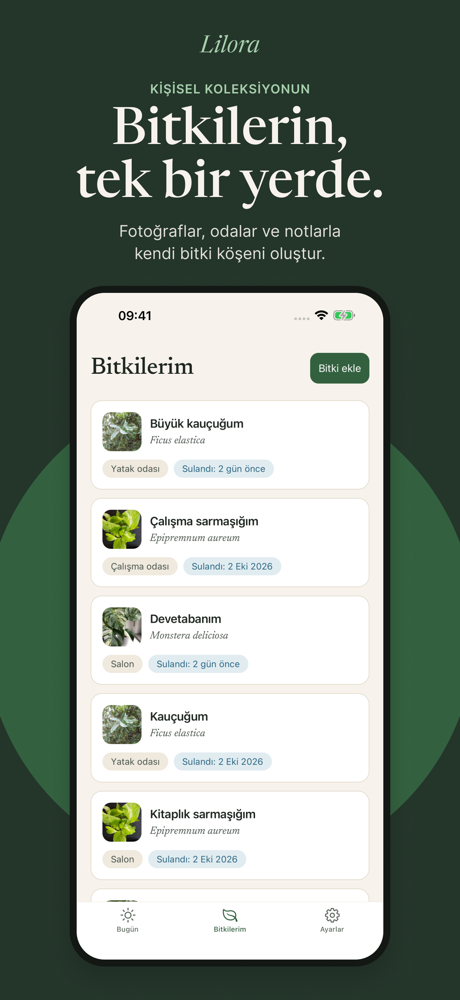
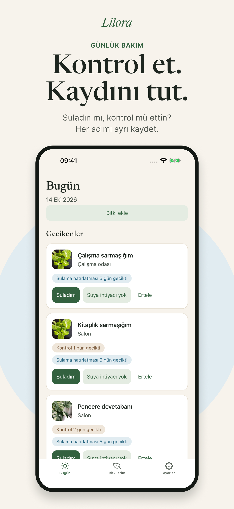
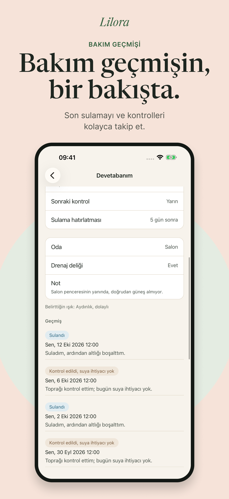

  <section class="promo-hero wrap">
    

Lilora
iPhone ve iPad için bitki bakım uygulaması

<h1>Hangi bitkiyle ne zaman ilgilendin?</h1>
Sulama ve kontrol geçmişini gör, bakım hatırlatmaları oluştur, evdekilerle aynı kaydı paylaş. Lilora ile ilk bitkini ücretsiz ekle; hesap açmadan başla.

    
Günlük bakım ücretsiz. · Hesap açmadan başla

    

<small class="promo-language">Ücretsiz indir · İsteğe bağlı uygulama içi satın alımlar</small><small class="promo-language">Uygulama Türkçe ve İngilizce</small>
<a class="text-link" href="#how-it-works">Nasıl çalıştığını gör ↓</a>

    <figure class="promo-qr promo-hero-qr"><figcaption>Telefonunla tara; Lilora’yı App Store’da aç.</figcaption></figure>

    <figure class="promo-hero-media">

<picture><source type="image/webp" srcset="/assets/images/home/app-tr-collection-320.webp 320w, /assets/images/home/app-tr-collection-480.webp 480w, /assets/images/home/app-tr-collection-720.webp 720w" sizes="(min-width: 1200px) 250px, (min-width: 900px) 23vw, (min-width: 600px) 260px, 43vw"></picture>

<picture><source type="image/webp" srcset="/assets/images/home/app-tr-care-320.webp 320w, /assets/images/home/app-tr-care-480.webp 480w, /assets/images/home/app-tr-care-720.webp 720w" sizes="(min-width: 1200px) 250px, (min-width: 900px) 23vw, (min-width: 600px) 260px, 43vw"></picture>

<figcaption class="promo-hero-caption">Gerçek uygulama ekranından hazırlanmış mağaza görseli; örnek bitki kayıtları içerir. Uygulama Türkçe gösteriliyor.</figcaption></figure>
  </section>
  <nav class="promo-paths wrap" aria-label="Nasıl çalıştığını gör"><a href="#how-it-works">Nasıl çalıştığını gör ↗</a><a href="#free-care">Günlük bakım ücretsiz. ↗</a><a href="/tr/guides/">Bitki bakımı ↗</a></nav>
  <section class="promo-how" id="how-it-works">

    

Evde bakımın akışı
<h2>Önce bak. Sonra yaptığını kaydet.</h2>
Bir hatırlatma, bitkinin su istediği anlamına gelmez. Lilora, gözlemini ve yaptığın bakımı evdekilerle paylaşabileceğin bir kayda dönüştürür.

    <ol class="promo-steps"><li>1
<h3>Bitkiyi ve toprağı kontrol et</h3>
Bugün ekranında kontrol zamanı gelen bitkileri gör. Sulamaya karar vermeden önce bitkine bak.

</li><li>2
<h3>Gerçekte yaptığını kaydet</h3>
“Suladım” ve “Suya ihtiyacı yok” ayrı kayıtlardır. Yalnızca kontrol ettiysen sulama kaydı oluşturmazsın.

</li><li>3
<h3>Evdekiler de bilsin</h3>
Özel ev grubunda kimin ne zaman bakım yaptığını gör. Bir sonraki kişi aynı bitkiyle ilgilenmeden önce geçmişe bakabilir.

</li></ol>

    
<figure class="promo-app"><picture><source type="image/webp" srcset="/assets/images/home/app-tr-care-320.webp 320w, /assets/images/home/app-tr-care-480.webp 480w, /assets/images/home/app-tr-care-720.webp 720w" sizes="(min-width: 900px) 260px, (min-width: 600px) 240px, 44vw"></picture><figcaption>Uygulama Türkçe gösteriliyor. Gerçek uygulama ekranından hazırlanmış mağaza görseli; örnek bitki kayıtları içerir.</figcaption></figure><figure class="promo-app"><picture><source type="image/webp" srcset="/assets/images/home/app-tr-history-320.webp 320w, /assets/images/home/app-tr-history-480.webp 480w, /assets/images/home/app-tr-history-720.webp 720w" sizes="(min-width: 900px) 260px, (min-width: 600px) 240px, 44vw"></picture><figcaption>Uygulama Türkçe gösteriliyor. Gerçek uygulama ekranından hazırlanmış mağaza görseli; örnek bitki kayıtları içerir.</figcaption></figure>

  
</section>
  <section class="wrap promo-features" id="features"><header class="promo-section-heading">
Lilora
<h2>Bitkinin yeri de, geçmişi de belli.</h2></header>
<article class="promo-feature-card">
    
01
<h3>Her bitkiye bir yer</h3>
Bitkilerini odalara ayır. Adını, fotoğraflarını ve notlarını aynı yerde tut; türünü bilmiyorsan da bitki ekleyebilirsin.

  </article><article class="promo-feature-card">
    
02
<h3>Sulamayı değil, bakmayı hatırla</h3>
Hatırlatmalar bitkini kontrol etmene yardımcı olur. Toprak hâlâ nemliyse sırf bildirim geldi diye sulaman gerekmez.

  </article><article class="promo-feature-card">
    
03
<h3>Kontrol ve sulama, ayrı ayrı</h3>
Bir bakışta son bakımı bul. Sulama ve kontrol kayıtlarını, kimin ne zaman yaptığını gösteren bir geçmişte takip et.

  </article><article class="promo-feature-card">
    
04
<h3>Aynı ev, ortak bakım</h3>
Hesabınla özel bir ev oluştur veya davet edildiğin eve katıl. Bitkileri ve bakım kayıtlarını ev grubundaki kişilerle paylaş.

  </article><article class="promo-feature-card">
    
05
<h3>Adını bulmak için bir seçenek</h3>
İstersen hesabınla fotoğraftan bitki tanımayı kullan. Pl@ntNet’in önerilerini gözden geçir; bitkini eklemeden önce sonucu sen onayla.

  </article><article class="promo-feature-card">
    
06
<h3>Hesap açmadan başla</h3>
Bitkilerini kendin ekleyebilir, fotoğraf, not ve bakım kaydı tutabilirsin. Misafir kayıtları yalnızca bu cihazda kalır; uygulamayı silersen bu kayıtlar da silinir.

  </article>
</section>
  <section class="promo-free" id="free-care">
<header class="promo-section-heading"><h2>Günlük bakım ücretsiz.</h2>
Bitkilerini kendin eklemek, odalara ayırmak, fotoğraf, not ve bakım geçmişi tutmak için satın alma gerekmez. Ücretli seçenekler, isteğe bağlı fotoğraftan bitki tanıma içindir.

<small class="promo-language">Ücretsiz indir · İsteğe bağlı uygulama içi satın alımlar</small><small class="promo-language">Uygulama Türkçe ve İngilizce</small>
</header>
<dl class="promo-plan-list">
<dt>Ücretsiz bitki defteri</dt><dd>Bitkiler, odalar, fotoğraflar, notlar ve bakım kayıtları.</dd>

<dt>Hesap başına 3 ücretsiz tanıma</dt><dd>Fotoğraftan bitki tanımayı denemek için. Her ay yenilenen bir hak değildir.</dd>

<dt>10 bitki tanıma paketi</dt><dd>Daha fazla bitki tanıma hakkı için isteğe bağlı tek seferlik satın alma.</dd>

<dt>Lilora Plus Aylık</dt><dd>Aylık yenilenen abonelikle her ay 30 bitki tanıma hakkı. Kullanılmayan haklar sonraki aya devretmez.</dd>
</dl>
Fiyatlar App Store’da kendi para biriminde gösterilir.

</section>
  {{HOME_EDITORIAL}}
  <section class="wrap promo-faq"><h2>Başlamadan önce</h2>

Lilora’yı şu anda indirebilir miyim?

Evet. Lilora, iPhone ve iPad için App Store’da. Elle bitki ekleme ve bakım kaydı ücretsiz.

Hangi cihazlarda ve dillerde çalışıyor?

Lilora, iPhone ve iPad için yayında. Uygulama Türkçe ve İngilizce; web sitesi on dilde.

Bitki bakımı için abonelik gerekiyor mu?

Hayır. Bitkilerini kendin eklemek ve bakım kaydı tutmak ücretsiz. Satın alma seçenekleri yalnızca isteğe bağlı fotoğraftan bitki tanıma hakkı sağlar.

Hesap açmak zorunda mıyım?

Kendi cihazında misafir olarak başlayabilirsin. Ev paylaşımı, fotoğraftan bitki tanıma ve satın alma için hesap gerekir. Misafir kayıtları cihazda tutulur ve uygulama silinince silinir.

Hatırlatma geldiğinde sulamalı mıyım?

Önce bitkiyi ve toprağı kontrol et. Bir hatırlatma sulama talimatı değildir. Su gerekmiyorsa bunu ayrı bir kontrol kaydı olarak kaydedebilirsin.

<a class="text-link" href="/tr/support/">Destek sayfasındaki tüm yanıtlar →</a>
</section>
  <section class="promo-band">

<h2>İlk bitkinle başla.</h2>
Bitkini ekle, yerini seç ve bugünkü bakımını kaydet. Günlük bakım için satın alma gerekmez.

<small class="promo-language">Uygulama Türkçe ve İngilizce</small>
App Store’da

<figure class="promo-qr"><figcaption>Telefonunla tara; Lilora’yı App Store’da aç.</figcaption></figure>
</section>
  

