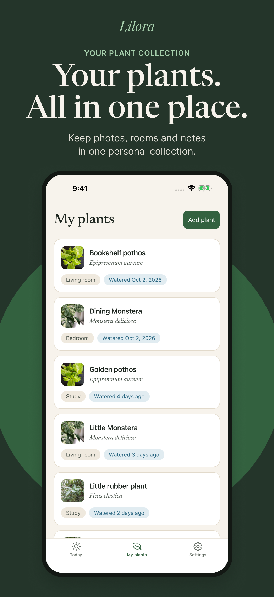
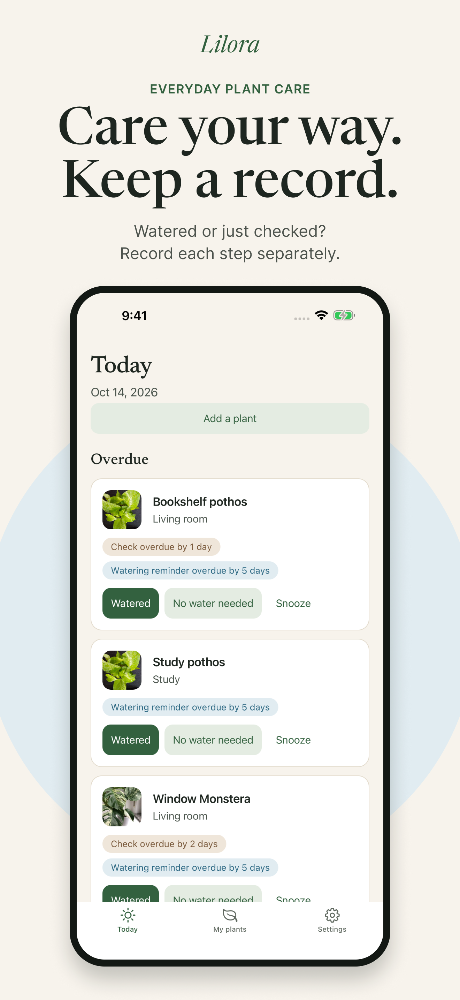
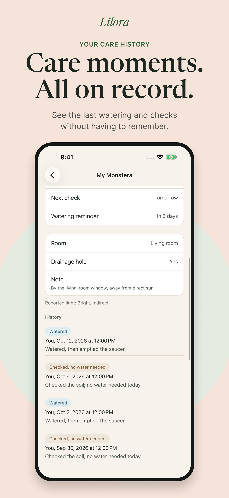

  <section class="promo-hero wrap">
    

Lilora
iPhone 與 iPad 植物照護應用程式

<h1>植物照護，一個 App 就能記錄。</h1>
拍照辨識植物、設定檢查提醒，集中記錄照護筆記。在 iPhone 或 iPad 下載 Lilora，與家人一起照顧植物。

    
日常照護免費使用。 · 不用帳號也能開始

    

<small class="promo-language">免費下載 · 提供選用 App 內購買</small><small class="promo-language">應用程式提供英文與土耳其文</small>
<a class="text-link" href="#how-it-works">了解使用方式 ↓</a>

    <figure class="promo-qr promo-hero-qr"><figcaption>用手機掃描，即可在 App Store 開啟 Lilora。</figcaption></figure>

    <figure class="promo-hero-media">

<picture><source type="image/webp" srcset="/assets/images/home/app-en-collection-320.webp 320w, /assets/images/home/app-en-collection-480.webp 480w, /assets/images/home/app-en-collection-720.webp 720w" sizes="(min-width: 1200px) 250px, (min-width: 900px) 23vw, (min-width: 600px) 260px, 43vw"></picture>

<picture><source type="image/webp" srcset="/assets/images/home/app-en-care-320.webp 320w, /assets/images/home/app-en-care-480.webp 480w, /assets/images/home/app-en-care-720.webp 720w" sizes="(min-width: 1200px) 250px, (min-width: 900px) 23vw, (min-width: 600px) 260px, 43vw"></picture>

<figcaption class="promo-hero-caption">以真實應用程式畫面及範例植物記錄製作的商店宣傳圖片。 圖中應用程式為英文介面。</figcaption></figure>
  </section>
  <nav class="promo-paths wrap" aria-label="了解使用方式"><a href="#how-it-works">了解使用方式 ↗</a><a href="#free-care">日常照護免費使用。 ↗</a><a href="/zh-hant/guides/">undefined ↗</a></nav>
  <section class="promo-how" id="how-it-works">

    

在家中如何一起使用
<h2>先觀察，再記錄做過的事。</h2>
收到提醒不代表植物需要澆水。Lilora 將觀察與照護整理成共用記錄，方便下一位照護者查看。

    <ol class="promo-steps"><li>1
<h3>檢查植物與介質</h3>
在英文介面的 Today（今日）查看哪些植物該檢查。先觀察，再決定是否澆水。

</li><li>2
<h3>記錄實際做過的事</h3>
英文介面的 Watered（已澆水）與 Checked, no water needed（已檢查，不需澆水）是不同的照護記錄。只檢查不會自動成為澆水記錄。

</li><li>3
<h3>讓家中其他人知道</h3>
在私人家庭群組中查看每株植物由誰、何時照護。下一個人可先讀取歷程，避免重複做同一件事。

</li></ol>

    
<figure class="promo-app"><picture><source type="image/webp" srcset="/assets/images/home/app-en-care-320.webp 320w, /assets/images/home/app-en-care-480.webp 480w, /assets/images/home/app-en-care-720.webp 720w" sizes="(min-width: 900px) 260px, (min-width: 600px) 240px, 44vw"></picture><figcaption>圖中應用程式為英文介面。 以真實應用程式畫面及範例植物記錄製作的商店宣傳圖片。</figcaption></figure><figure class="promo-app"><picture><source type="image/webp" srcset="/assets/images/home/app-en-history-320.webp 320w, /assets/images/home/app-en-history-480.webp 480w, /assets/images/home/app-en-history-720.webp 720w" sizes="(min-width: 900px) 260px, (min-width: 600px) 240px, 44vw"></picture><figcaption>圖中應用程式為英文介面。 以真實應用程式畫面及範例植物記錄製作的商店宣傳圖片。</figcaption></figure>

  
</section>
  <section class="wrap promo-features" id="features"><header class="promo-section-heading">
Lilora
<h2>安置植物，也留下照護記錄。</h2></header>
<article class="promo-feature-card">
    
01
<h3>每株植物都有自己的房間</h3>
按房間整理植物。即使不知道植物的種類，也能把名字、照片與筆記放在一起。

  </article><article class="promo-feature-card">
    
02
<h3>提醒您再看一眼</h3>
提醒讓您回到植物身邊，先檢查狀況，而不是在介質仍濕時自動澆水。

  </article><article class="promo-feature-card">
    
03
<h3>檢查與澆水，分開記錄</h3>
一眼找到上次照護記錄。分開的澆水與檢查記錄，清楚呈現誰在何時做了什麼。

  </article><article class="promo-feature-card">
    
04
<h3>一個家，一起照護</h3>
使用帳號建立私人家庭群組，或接受邀請加入。與同群組的人分享植物與照護記錄。

  </article><article class="promo-feature-card">
    
05
<h3>為植物找到名字的一點幫助</h3>
有帳號即可選用照片辨識。查看 Pl@ntNet 提供的候選結果，確認後再新增植物。

  </article><article class="promo-feature-card">
    
06
<h3>不用帳號也能開始</h3>
自行新增植物並保留照片、筆記與照護記錄。訪客記錄留在這部裝置上；刪除應用程式也會刪除這些記錄。

  </article>
</section>
  <section class="promo-free" id="free-care">
<header class="promo-section-heading"><h2>日常照護免費使用。</h2>
自行新增植物、整理房間，以及保存照片、筆記與照護歷程，都不需要購買。付費選項只用於選用的照片辨識。

<small class="promo-language">免費下載 · 提供選用 App 內購買</small><small class="promo-language">應用程式提供英文與土耳其文</small>
</header>
<dl class="promo-plan-list">
<dt>免費植物筆記</dt><dd>植物、房間、照片、筆記與照護記錄。</dd>

<dt>每個帳號 3 次免費辨識</dt><dd>供初次體驗照片辨識的額度，不會每月重新提供。</dd>

<dt>10 次辨識組合</dt><dd>需要更多辨識次數時，可選擇單次購買。</dd>

<dt>Lilora Plus Monthly</dt><dd>每月自動續訂，提供每月 30 次辨識。未使用次數不會累計至下個月。</dd>
</dl>
App Store 會以您的貨幣顯示價格。

</section>
  {{HOME_EDITORIAL}}
  <section class="wrap promo-faq"><h2>開始之前</h2>

現在可以下載 Lilora 嗎？

可以。Lilora 已在 App Store 推出，支援 iPhone 與 iPad。手動記錄植物與照護完全免費。

支援哪些裝置與語言？

Lilora 已推出 iPhone 與 iPad 版本。應用程式提供英文與土耳其文；網站提供十種語言。

照護植物需要訂閱嗎？

不需要。自行新增植物與記錄照護都是免費的。購買項目僅提供選用照片辨識的額度。

需要帳號嗎？

您可以先在自己的裝置上以訪客身分使用。家庭群組共享、照片辨識及購買需要帳號。訪客記錄儲存在裝置上，刪除應用程式時也會刪除。

收到提醒就應該澆水嗎？

先檢查植物與介質。提醒不是澆水指令。如果不需要水，可以另行記錄這次檢查。

<a class="text-link" href="/zh-hant/support/">到支援頁面尋找更多解答 →</a>
</section>
  <section class="promo-band">

<h2>讓下次檢查有實用的歷程可查。</h2>
在 App Store 開啟 Lilora，或用 iPhone 或 iPad 掃描這個代碼。

<small class="promo-language">應用程式提供英文與土耳其文</small>
已在 App Store 推出

<figure class="promo-qr"><figcaption>用手機掃描，即可在 App Store 開啟 Lilora。</figcaption></figure>
</section>
  

